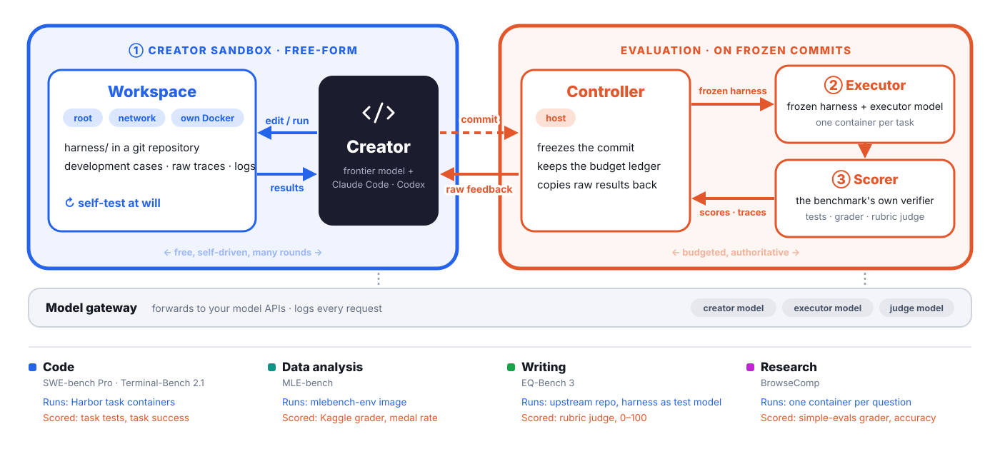

<h1 align="center">HarnessDev</h1>

<p align="center"><strong>Can LLMs create and evolve their own agent harness?</strong></p>

<p align="center">
  <a href="README.md">English</a> | <a href="README_zh.md">中文</a>
</p>

<p align="center">
  <a href="https://arxiv.org/abs/2609.01437">Paper</a> · <a href="https://self-developing-agents.github.io">Project page</a>
</p>

---

## Overview

An agent is a model plus a **harness**: the execution loop, tools, context management, state, recovery and verification around the model. Agent benchmarks score task outputs under a harness that humans wrote. **HarnessDev** scores the harness itself, as built by an LLM.

A *creator* (a model driving Claude Code or Codex) works in a sandbox with the freedom of a human engineer: root, network, a private Docker daemon, real benchmark tasks to test on, raw execution traces to read. What it delivers is a runnable harness. The framework freezes that harness, runs it with an *executor* model on public benchmarks through their own runners and scorers, and reports task success and execution-token cost.

Two stages:

- **Creation (RQ1).** The creator starts from a weak seed harness, a task specification and one to three development cases, and builds a complete harness. The harness is frozen and then evaluated on the full benchmark. Four domains, five benchmarks.
- **Evolution (RQ2).** The creator starts from its own Creation code harness H0 and improves it from execution feedback on a feedback set: 100 SWE-Pro tasks and all 89 Terminal-Bench tasks. The budget is ten full-evaluation pairs, and the creator ends the run by declaring a final version. Afterwards every official version is evaluated on a held-out set of 630 SWE-Pro instances disjoint from the feedback set; these scores are not returned to the creator.

## Results

### Creation

The creator model is also the executor. Each creator independently builds three harnesses per benchmark, and scores are avg@3 in each benchmark's native metric. *tok.* is mean execution tokens per harness, in millions. *Avg.* is the unweighted mean over SWE-Pro, Terminal-Bench, EQ-Bench3 and BrowseComp.

<table>
  <thead>
    <tr>
      <th rowspan="2" align="left">Creator</th>
      <th colspan="2" align="center">SWE-Pro</th>
      <th colspan="2" align="center">Term.-2.1</th>
      <th colspan="2" align="center">MLE-bench</th>
      <th colspan="2" align="center">EQ-Bench3</th>
      <th colspan="2" align="center">BrowseComp</th>
      <th rowspan="2" align="center">Avg.</th>
    </tr>
    <tr>
      <th align="right">succ.</th><th align="right">tok.</th>
      <th align="right">acc.</th><th align="right">tok.</th>
      <th align="right">medal</th><th align="right">tok.</th>
      <th align="right">score</th><th align="right">tok.</th>
      <th align="right">acc.</th><th align="right">tok.</th>
    </tr>
  </thead>
  <tbody>
    <tr><td align="left"><i>Seed&nbsp;harness</i></td><td align="right">0.0</td><td align="right">—</td><td align="right">0.0</td><td align="right">—</td><td align="right">0.0</td><td align="right">—</td><td align="right">0.0</td><td align="right">—</td><td align="right">0.0</td><td align="right">—</td><td align="right">0.0</td></tr>
    <tr><td align="left"><b>Opus&nbsp;4.8</b></td><td align="right"><b>69.3</b></td><td align="right">759.5</td><td align="right">64.8</td><td align="right">46.2</td><td align="right"><b>32.9</b></td><td align="right">101.7</td><td align="right"><b>84.6</b></td><td align="right">3.1</td><td align="right">52.4</td><td align="right">593.9</td><td align="right"><b>67.8</b></td></tr>
    <tr><td align="left">Gemini&nbsp;3.1&nbsp;Pro</td><td align="right">43.6</td><td align="right">783.6</td><td align="right"><b>68.8</b></td><td align="right">177.1</td><td align="right">32.4</td><td align="right">131.3</td><td align="right">74.8</td><td align="right">5.2</td><td align="right">35.2</td><td align="right">267.4</td><td align="right">55.6</td></tr>
    <tr><td align="left">GPT-5.5</td><td align="right">32.8</td><td align="right">325.6</td><td align="right">52.1</td><td align="right">12.2</td><td align="right">19.1</td><td align="right">29.3</td><td align="right">83.0</td><td align="right">4.9</td><td align="right"><b>52.6</b></td><td align="right">313.5</td><td align="right">55.1</td></tr>
    <tr><td align="left">DeepSeek&nbsp;V4&nbsp;Pro</td><td align="right">28.9</td><td align="right">739.7</td><td align="right">35.6</td><td align="right">35.2</td><td align="right">19.6</td><td align="right">208.4</td><td align="right">75.4</td><td align="right">4.9</td><td align="right">40.9</td><td align="right">1,449.9</td><td align="right">45.2</td></tr>
    <tr><td align="left">Qwen&nbsp;3.7&nbsp;Max</td><td align="right">33.5</td><td align="right">421.9</td><td align="right">41.3</td><td align="right">19.3</td><td align="right">3.1</td><td align="right">42.9</td><td align="right">68.7</td><td align="right">4.3</td><td align="right">32.3</td><td align="right">130.9</td><td align="right">44.0</td></tr>
    <tr><td align="left">Seed&nbsp;2.0&nbsp;Pro</td><td align="right">10.8</td><td align="right">454.4</td><td align="right">6.0</td><td align="right">23.0</td><td align="right">5.3</td><td align="right">557.1</td><td align="right">71.1</td><td align="right">9.0</td><td align="right">3.2</td><td align="right">610.2</td><td align="right">22.8</td></tr>
    <tr><td align="left"><i>Human&nbsp;harness<br>+&nbsp;paired&nbsp;model</i></td><td align="right">80.0</td><td align="right">—</td><td align="right">88.8</td><td align="right">—</td><td align="right">24.0</td><td align="right">66.5</td><td align="right">83.7</td><td align="right">9.2</td><td align="right">92.2</td><td align="right">—</td><td align="right">86.2</td></tr>
  </tbody>
</table>

### Evolution

The feedback pair is the unweighted mean of the SWE-Pro-100 and Terminal-Bench-89 scores; the held-out column is SWE-Pro-630, run after the trajectory ends. Each cell is H0 → the declared final version.

| Executor | Creator | Feedback pair | Held-out-630 |
|:--|:--|:--|:--|
| Self | Gemini 3.1 Pro | 59.9 → 68.7 (+8.8) | 48.89 → 51.59 (+2.70) |
| Self | Opus 4.8 | 71.1 → 74.1 (+3.0) | 63.02 → 67.46 (+4.44) |
| Self | Qwen 3.7 Max | 41.8 → 55.7 (+13.9) | 42.22 → 43.65 (+1.43) |
| Self | DeepSeek V4 Pro | 47.2 → 60.6 (+13.4) | 47.30 → 50.48 (+3.17) |
| Self | GPT-5.5 | 59.2 → 65.1 (+5.9) | 48.25 → 52.06 (+3.81) |
| Self | Seed 2.1 Turbo† | 53.4 → 54.0 (+0.6) | 40.48 → 43.33 (+2.86) |
| Fixed Gemini | Opus 4.8 | 58.8 → 68.6 (+9.7) | 48.10 → 50.79 (+2.70) |
| Fixed Gemini | Qwen 3.7 Max | 62.1 → 63.2 (+1.1) | 49.52 → 48.41 (−1.11) |
| Fixed Gemini | DeepSeek V4 Pro | 47.3 → 53.8 (+6.5) | 43.02 → 40.63 (−2.38) |
| Fixed Gemini | GPT-5.5 | 56.6 → 59.1 (+2.4) | 42.22 → 31.90 (−10.32) |
| Fixed Gemini | Seed 2.1 Turbo | 50.0 → 58.2 (+8.2) | 41.43 → 48.10 (+6.67) |

† This lineage ended without a final declaration; its last official version is used.

## How it runs

<p align="center">
  
</p>

- **Creator sandbox.** A container the creator owns. It commits harness versions to a git repository and talks to the controller through the `hd` tool.
- **Executor environment.** Each benchmark task runs in its own container with the frozen harness uploaded. Code tasks run under [Harbor](https://github.com/harbor-framework/harbor), so they can move from local Docker to Daytona, Modal or E2B with one setting.
- **Scorer.** Each benchmark's public verifier or grader.
- **Controller.** Freezes commits, runs evaluations, keeps the budget ledger, copies raw results back. Which version to keep, when to submit and which one is final are the creator's decisions.
- **Model gateway.** Forwards model requests to your APIs. Every request is logged with its token usage, per role and per evaluation.

## Benchmarks

| Domain | Benchmark | Runner and scorer | Metric |
|:--|:--|:--|:--|
| Code | [SWE-bench Pro](https://github.com/scaleapi/SWE-bench_Pro-os) (730) | Harbor adapter, task verifier | task success |
| Code | [Terminal-Bench 2.1](https://github.com/harbor-framework/terminal-bench-2-1) (89) | Harbor, task verifier | task success |
| Data analysis | [MLE-bench](https://github.com/openai/mle-bench) (75) | `mlebench-env` image, `mlebench grade-sample` | medal rate |
| Writing | [EQ-Bench 3](https://github.com/EQ-bench/eqbench3) | upstream repository, rubric judge | rubric score, 0–100 |
| Research | [BrowseComp](https://github.com/openai/simple-evals) (1,266) | simple-evals dataset and grader | accuracy |

Task ids of every split are in [`harnessdev/manifests/`](harnessdev/manifests): `dev` holds the development cases the creator can run itself, `test` is the Creation evaluation set, and `feedback`, `probe` and `heldout` are the Evolution sets.

## Quick start

Requirements: Linux x86-64, Docker with Compose v2 and Buildx 0.17+, Python 3.12+. The data domain also needs `git-lfs` and Kaggle credentials in `~/.kaggle/kaggle.json`; `harnessdev prepare` installs MLE-bench from its repository.

```bash
git clone https://github.com/EuanZ/harnessdev.git && cd harnessdev
pip install -e ".[code]"
harnessdev build                 # creator and runner images
```

Run Creation, then Evolution, for the code domain:

```bash
export CREATOR_API_KEY=... EXECUTOR_API_KEY=...
harnessdev run -e experiments/rq1_code.yaml --run-id create-001
harnessdev run -e experiments/rq2_code.yaml --run-id evolve-001 \
    --seed-harness runs/create-001/submissions/final/harness
harnessdev report
```

The first `run` is Creation: the creator builds a harness from the weak seed, and the frozen result is evaluated on all 730 SWE-Pro instances and all 89 Terminal-Bench tasks. The second is Evolution from that harness: the H0 evaluation, ten feedback pairs, the final declaration, then the 630-instance held-out evaluation. `harnessdev report` prints the scores of every finished run.

The other domains run the same way with `experiments/rq1_data.yaml`, `rq1_writing.yaml` and `rq1_search.yaml`. `harnessdev list` prints every benchmark with its splits.

To score an existing harness directory without a creator, for example the seed on the development cases:

```bash
harnessdev evaluate -e experiments/rq1_code.yaml --harness harnessdev/assets/weak_seed --split dev
```

## Experiment file

```yaml
rq: rq2                          # rq1: creation, rq2: evolution
domain: code                     # code | data | writing | search
seed_harness: runs/create-001/submissions/final/harness

models:
  creator:  {model: gpt-5.5, api_base_url: https://api.openai.com/v1, api_key: ${CREATOR_API_KEY}, protocol: openai}
  executor: {model: gpt-5.5, api_base_url: https://api.openai.com/v1, api_key: ${EXECUTOR_API_KEY}, protocol: openai}

creator:  {agent: codex, timeout: 604800}
evolve:   {max_pairs: 10, probes_per_round: 2, probe_size: 5, serial: false, heldout: all}
executor: {n_concurrent: 16, max_steps: 500, environment: docker}
```

Setting the executor to the creator's model gives the paper's *Self* setting; pointing every creator at one executor gives the *Fixed* setting. `protocol` is the wire API of the upstream (`openai` or `anthropic`); to drive Claude Code with an OpenAI-protocol model, put a translating proxy such as LiteLLM at `api_base_url`.

Two environment variables adjust the host setup:

| Variable | Effect |
|:--|:--|
| `HDEV_DATASET_SWEBENCH_PRO`, `HDEV_DATASET_TERMINAL_BENCH` | Path to a local directory of Harbor tasks. The benchmark is loaded from it instead of the Harbor registry. |
| `HDEV_ADVERTISE_HOST` | Address at which containers reach the controller and the gateway on the host. The default is `host.docker.internal` on macOS and the Docker bridge gateway on Linux. |

## The harness contract

A harness is a directory with a `harness/` Python package. Its internals are the creator's design. One entry point is fixed:

```bash
python3 -m harness run --task-json task.json --model-config model.json --output-dir out --max-steps 500
```

`task.json` carries the instruction and the working directory; `model.json` carries the executor endpoint. The harness writes `result.json`, `trajectory.jsonl` and, for writing and search, `response.md`. Code tasks are scored on the state of the working directory. The full contract is in [`harnessdev/contract.py`](harnessdev/contract.py).

## Inside the creator sandbox

```text
hd selftest [--benchmark B] [--task ID ...]   run the workspace harness on development cases
hd submit-pair [--commit SHA]                 billed full evaluation of one commit
hd submit-probe [--commit SHA]                fixed-subset probe of one commit
hd list-evals | hd eval-status --eval-id ID
hd read-feedback --since SEQ | hd wait-feedback --since SEQ
hd budget
hd declare-final [--commit SHA]
```

`hd selftest` runs development cases on the sandbox's private Docker daemon. Feedback arrives under `feedback/` as an append-only event stream plus one directory per evaluation, holding each task's score, the scorer's output and the harness's own trace.

The Evolution protocol: 10 billed pairs, each a full evaluation on every benchmark; at most 2 probes between pairs, each on a fixed 5-task subset per benchmark; the run ends when the creator declares a version that has a completed full evaluation on every benchmark. `evolve.serial: true` pauses the creator until each pair's feedback is delivered.

## Run output

```text
runs/<run-id>/
├── run_config.json        resolved configuration, keys removed
├── events.jsonl           controller log
├── llm_requests.jsonl     one line per model request: role, evaluation, tokens
├── usage.json             token totals per role
├── creator/               prompt, agent output, native session files
├── submissions/<id>/      frozen snapshot of every submitted commit
├── feedback/              what the creator received: events.jsonl, evals/<eval-id>/
├── heldout/<id>/          held-out evaluation of official versions
├── final.json             the declared final version
└── summary.json           scores of the run: final version, every official version, held-out results
```

## Repository layout

```text
harnessdev/
├── cli.py                 harnessdev command
├── sandbox_tool.py        hd command
├── contract.py            harness entry point
├── controller/            controller, HTTP API, creation and evolution flows, ledger
├── gateway/               model gateway: forwards sandbox model requests to your APIs, logs token usage
├── backends/              Docker sandbox backend
├── creators/              Claude Code and Codex launchers
├── executor/              Harbor agent that runs a frozen harness
├── benchmarks/            five benchmark adapters
├── manifests/             split task ids
├── assets/prompts/        the prompts given to the creator
└── assets/                weak seed, Dockerfiles
experiments/               example experiment files
```

## Citation

```bibtex
@misc{zhang2026harnessdev,
  title         = {HarnessDev: Can LLMs Create and Evolve Their Own Agent Harness?},
  author        = {Zhang, Jingyuan and Wu, Yuhao and Shi, Jiajun and Lei, Xinping and Gu, Qingshui and Zhang, Yuxuan and Wang, Zexuan and He, Chen and Huang, Chen and Song, Maojia and Zeng, Zhiyuan and Wang, Shaowen and Liu, Jinkai and Shi, Yunfeng and Liu, Jiaheng and Yan, Shen and Huang, Wenhao and Zhang, Ge and Zhang, Wenxuan},
  year          = {2026},
  eprint        = {2609.01437},
  archivePrefix = {arXiv},
  primaryClass  = {cs.SE},
}
```

## License

[Apache License 2.0](LICENSE).
