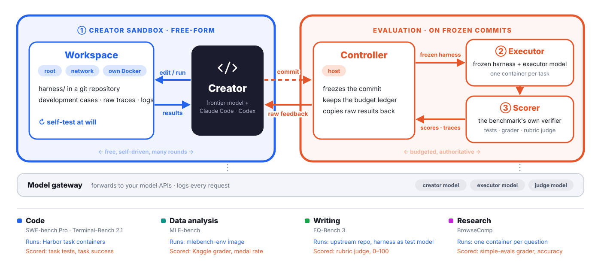

<h1 align="center">HarnessDev</h1>

<p align="center"><strong>LLM 能创建并演化自己的 agent harness 吗？</strong></p>

<p align="center">
  <a href="README.md">English</a> | <a href="README_zh.md">中文</a>
</p>

<p align="center">
  <a href="https://arxiv.org/abs/2609.01437">论文</a> · <a href="https://self-developing-agents.github.io">项目主页</a>
</p>

---

## 概览

一个 agent 等于模型加上 **harness**：模型之外的执行循环、工具、上下文管理、状态、恢复与验证。现有 agent benchmark 评的是在人写的 harness 下的任务输出。**HarnessDev** 评的是 harness 本身，并且这个 harness 由 LLM 来构建。

*Creator*（驱动 Claude Code 或 Codex 的模型）在沙箱里工作，拥有和人类工程师一样的自由度：root、联网、独立的 Docker 守护进程、可以拿来自测的真实 benchmark 题目、可以直接阅读的原始执行轨迹。它交付的是一个可运行的 harness。框架把这个 harness 冻结，用 *Executor* 模型驱动它，通过各公开 benchmark 自带的 runner 和 scorer 跑分，报告任务成功率和执行 token 成本。

两个阶段：

- **创建（RQ1）。** Creator 从一个弱种子 harness、一份任务说明和 1 到 3 个开发样例出发，构建完整的 harness。harness 冻结后在完整 benchmark 上评测。覆盖四个领域、五个 benchmark。
- **演化（RQ2）。** Creator 从自己在创建阶段产出的 code harness H0 出发，根据反馈集上的执行反馈改进它。反馈集是 100 道 SWE-Pro 题加全部 89 道 Terminal-Bench 题。预算是 10 个全量评测 pair，Creator 声明最终版本后实验结束。之后每个正式版本都会在 held-out 集上评测：630 道与反馈集不重叠的 SWE-Pro 题，这些分数不返回给 Creator。

## 结果

### 创建

Creator 模型同时担任 Executor。每个 Creator 在每个 benchmark 上独立构建三个 harness，分数为各 benchmark 原生指标的 avg@3。*tok.* 是每个 harness 的平均执行 token，单位为百万。*平均* 是 SWE-Pro、Terminal-Bench、EQ-Bench3 和 BrowseComp 四项的等权均值。

<table>
  <thead>
    <tr>
      <th rowspan="2" align="left">Creator</th>
      <th colspan="2" align="center">SWE-Pro</th>
      <th colspan="2" align="center">Term.-2.1</th>
      <th colspan="2" align="center">MLE-bench</th>
      <th colspan="2" align="center">EQ-Bench3</th>
      <th colspan="2" align="center">BrowseComp</th>
      <th rowspan="2" align="center">平均</th>
    </tr>
    <tr>
      <th align="right">succ.</th><th align="right">tok.</th>
      <th align="right">acc.</th><th align="right">tok.</th>
      <th align="right">medal</th><th align="right">tok.</th>
      <th align="right">score</th><th align="right">tok.</th>
      <th align="right">acc.</th><th align="right">tok.</th>
    </tr>
  </thead>
  <tbody>
    <tr><td align="left"><i>种子&nbsp;harness</i></td><td align="right">0.0</td><td align="right">—</td><td align="right">0.0</td><td align="right">—</td><td align="right">0.0</td><td align="right">—</td><td align="right">0.0</td><td align="right">—</td><td align="right">0.0</td><td align="right">—</td><td align="right">0.0</td></tr>
    <tr><td align="left"><b>Opus&nbsp;4.8</b></td><td align="right"><b>69.3</b></td><td align="right">759.5</td><td align="right">64.8</td><td align="right">46.2</td><td align="right"><b>32.9</b></td><td align="right">101.7</td><td align="right"><b>84.6</b></td><td align="right">3.1</td><td align="right">52.4</td><td align="right">593.9</td><td align="right"><b>67.8</b></td></tr>
    <tr><td align="left">Gemini&nbsp;3.1&nbsp;Pro</td><td align="right">43.6</td><td align="right">783.6</td><td align="right"><b>68.8</b></td><td align="right">177.1</td><td align="right">32.4</td><td align="right">131.3</td><td align="right">74.8</td><td align="right">5.2</td><td align="right">35.2</td><td align="right">267.4</td><td align="right">55.6</td></tr>
    <tr><td align="left">GPT-5.5</td><td align="right">32.8</td><td align="right">325.6</td><td align="right">52.1</td><td align="right">12.2</td><td align="right">19.1</td><td align="right">29.3</td><td align="right">83.0</td><td align="right">4.9</td><td align="right"><b>52.6</b></td><td align="right">313.5</td><td align="right">55.1</td></tr>
    <tr><td align="left">DeepSeek&nbsp;V4&nbsp;Pro</td><td align="right">28.9</td><td align="right">739.7</td><td align="right">35.6</td><td align="right">35.2</td><td align="right">19.6</td><td align="right">208.4</td><td align="right">75.4</td><td align="right">4.9</td><td align="right">40.9</td><td align="right">1,449.9</td><td align="right">45.2</td></tr>
    <tr><td align="left">Qwen&nbsp;3.7&nbsp;Max</td><td align="right">33.5</td><td align="right">421.9</td><td align="right">41.3</td><td align="right">19.3</td><td align="right">3.1</td><td align="right">42.9</td><td align="right">68.7</td><td align="right">4.3</td><td align="right">32.3</td><td align="right">130.9</td><td align="right">44.0</td></tr>
    <tr><td align="left">Seed&nbsp;2.0&nbsp;Pro</td><td align="right">10.8</td><td align="right">454.4</td><td align="right">6.0</td><td align="right">23.0</td><td align="right">5.3</td><td align="right">557.1</td><td align="right">71.1</td><td align="right">9.0</td><td align="right">3.2</td><td align="right">610.2</td><td align="right">22.8</td></tr>
    <tr><td align="left"><i>人类&nbsp;harness&nbsp;+&nbsp;对应模型</i></td><td align="right">80.0</td><td align="right">—</td><td align="right">88.8</td><td align="right">—</td><td align="right">24.0</td><td align="right">66.5</td><td align="right">83.7</td><td align="right">9.2</td><td align="right">92.2</td><td align="right">—</td><td align="right">86.2</td></tr>
  </tbody>
</table>

### 演化

反馈集 pair 分数是 SWE-Pro-100 与 Terminal-Bench-89 的等权均值；held-out 一列是 SWE-Pro-630，在演化轨迹结束后评测。每格为 H0 → Creator 声明的最终版本。

| Executor | Creator | 反馈集 pair | Held-out-630 |
|:--|:--|:--|:--|
| 自身 | Gemini 3.1 Pro | 59.9 → 68.7 (+8.8) | 48.89 → 51.59 (+2.70) |
| 自身 | Opus 4.8 | 71.1 → 74.1 (+3.0) | 63.02 → 67.46 (+4.44) |
| 自身 | Qwen 3.7 Max | 41.8 → 55.7 (+13.9) | 42.22 → 43.65 (+1.43) |
| 自身 | DeepSeek V4 Pro | 47.2 → 60.6 (+13.4) | 47.30 → 50.48 (+3.17) |
| 自身 | GPT-5.5 | 59.2 → 65.1 (+5.9) | 48.25 → 52.06 (+3.81) |
| 自身 | Seed 2.1 Turbo† | 53.4 → 54.0 (+0.6) | 40.48 → 43.33 (+2.86) |
| 固定 Gemini | Opus 4.8 | 58.8 → 68.6 (+9.7) | 48.10 → 50.79 (+2.70) |
| 固定 Gemini | Qwen 3.7 Max | 62.1 → 63.2 (+1.1) | 49.52 → 48.41 (−1.11) |
| 固定 Gemini | DeepSeek V4 Pro | 47.3 → 53.8 (+6.5) | 43.02 → 40.63 (−2.38) |
| 固定 Gemini | GPT-5.5 | 56.6 → 59.1 (+2.4) | 42.22 → 31.90 (−10.32) |
| 固定 Gemini | Seed 2.1 Turbo | 50.0 → 58.2 (+8.2) | 41.43 → 48.10 (+6.67) |

† 该轨迹结束时没有声明最终版本，取它的最后一个正式版本。

## 运行结构

<p align="center">
  
</p>

- **Creator 沙箱。** 归 Creator 所有的容器。它把 harness 版本提交到 git 仓库，通过 `hd` 工具与 Controller 通信。
- **Executor 环境。** 每道 benchmark 题在独立容器里运行，容器内放入冻结的 harness。Code 题目由 [Harbor](https://github.com/harbor-framework/harbor) 运行，改一个配置就能从本机 Docker 换到 Daytona、Modal 或 E2B。
- **Scorer。** 各 benchmark 公开的 verifier 或 grader。
- **Controller。** 冻结 commit、运行评测、记录预算账本、把原始结果拷回沙箱。保留哪个版本、何时提交、哪个是最终版本，都由 Creator 决定。
- **模型网关。** 把模型请求转发到你的 API。每次请求都按角色和所属评测记录 token 用量。

## Benchmark

| 领域 | Benchmark | Runner 与 scorer | 指标 |
|:--|:--|:--|:--|
| Code | [SWE-bench Pro](https://github.com/scaleapi/SWE-bench_Pro-os)（730） | Harbor adapter，题目自带 verifier | 任务成功率 |
| Code | [Terminal-Bench 2.1](https://github.com/harbor-framework/terminal-bench-2-1)（89） | Harbor，题目自带 verifier | 任务成功率 |
| Data analysis | [MLE-bench](https://github.com/openai/mle-bench)（75） | `mlebench-env` 镜像，`mlebench grade-sample` | 获奖牌率 |
| Writing | [EQ-Bench 3](https://github.com/EQ-bench/eqbench3) | 上游仓库，rubric judge | rubric 分数，0–100 |
| Research | [BrowseComp](https://github.com/openai/simple-evals)（1,266） | simple-evals 的数据集与 grader | 准确率 |

每个 split 的题目 id 在 [`harnessdev/manifests/`](harnessdev/manifests)：`dev` 是 Creator 可以自己运行的开发样例，`test` 是创建阶段的评测集，`feedback`、`probe` 和 `heldout` 是演化阶段的三个集合。

## 快速开始

环境要求：Linux x86-64、Docker（含 Compose v2 和 Buildx 0.17+）、Python 3.12+。data 域另外需要 `git-lfs` 和放在 `~/.kaggle/kaggle.json` 的 Kaggle 凭证；`harnessdev prepare` 会从官方仓库安装 MLE-bench。

```bash
git clone https://github.com/EuanZ/harnessdev.git && cd harnessdev
pip install -e ".[code]"
harnessdev build                 # 构建 Creator 与 runner 镜像
```

跑 code 领域的创建，再跑演化：

```bash
export CREATOR_API_KEY=... EXECUTOR_API_KEY=...
harnessdev run -e experiments/rq1_code.yaml --run-id create-001
harnessdev run -e experiments/rq2_code.yaml --run-id evolve-001 \
    --seed-harness runs/create-001/submissions/final/harness
harnessdev report
```

第一条 `run` 是创建：Creator 从弱种子构建 harness，冻结后在全部 730 道 SWE-Pro 题和全部 89 道 Terminal-Bench 题上评测。第二条是从这个 harness 出发的演化：H0 评测、10 个反馈 pair、声明最终版本，然后是 630 题的 held-out 评测。`harnessdev report` 打印所有已完成运行的分数。

其他领域用法相同，配置文件是 `experiments/rq1_data.yaml`、`rq1_writing.yaml` 和 `rq1_search.yaml`。`harnessdev list` 列出每个 benchmark 及其 split。

不经过 Creator、直接给一个已有的 harness 目录打分，例如在开发样例上跑种子：

```bash
harnessdev evaluate -e experiments/rq1_code.yaml --harness harnessdev/assets/weak_seed --split dev
```

## 实验配置

```yaml
rq: rq2                          # rq1：创建，rq2：演化
domain: code                     # code | data | writing | search
seed_harness: runs/create-001/submissions/final/harness

models:
  creator:  {model: gpt-5.5, api_base_url: https://api.openai.com/v1, api_key: ${CREATOR_API_KEY}, protocol: openai}
  executor: {model: gpt-5.5, api_base_url: https://api.openai.com/v1, api_key: ${EXECUTOR_API_KEY}, protocol: openai}

creator:  {agent: codex, timeout: 604800}
evolve:   {max_pairs: 10, probes_per_round: 2, probe_size: 5, serial: false, heldout: all}
executor: {n_concurrent: 16, max_steps: 500, environment: docker}
```

把 executor 设成 Creator 的模型，就是论文里的 *Self* 设定；让所有 Creator 共用一个 executor，就是 *Fixed* 设定。`protocol` 是上游接口的协议（`openai` 或 `anthropic`）；要用 Claude Code 驱动 OpenAI 协议的模型，把 `api_base_url` 指向 LiteLLM 这类转换代理即可。

有两个环境变量可以调整宿主机一侧的设置：

| 变量 | 作用 |
|:--|:--|
| `HDEV_DATASET_SWEBENCH_PRO`、`HDEV_DATASET_TERMINAL_BENCH` | 本地 Harbor 题目目录的路径。设置后从该目录加载 benchmark，不再从 Harbor registry 拉取。 |
| `HDEV_ADVERTISE_HOST` | 容器访问宿主机上 Controller 和网关所用的地址。默认在 macOS 上是 `host.docker.internal`，在 Linux 上是 Docker bridge 网关。 |

## Harness 契约

harness 是一个包含 `harness/` Python 包的目录，内部实现由 Creator 设计。固定的只有一个入口：

```bash
python3 -m harness run --task-json task.json --model-config model.json --output-dir out --max-steps 500
```

`task.json` 给出任务说明和工作目录；`model.json` 给出 Executor 模型的接入点。harness 写出 `result.json`、`trajectory.jsonl`，Writing 和 Search 领域还要写 `response.md`。Code 题目按工作目录的最终状态评分。完整契约见 [`harnessdev/contract.py`](harnessdev/contract.py)。

## Creator 沙箱内的工具

```text
hd selftest [--benchmark B] [--task ID ...]   在开发样例上运行当前工作区的 harness
hd submit-pair [--commit SHA]                 对一个 commit 做计费的全量评测
hd submit-probe [--commit SHA]                对一个 commit 做固定子集 probe
hd list-evals | hd eval-status --eval-id ID
hd read-feedback --since SEQ | hd wait-feedback --since SEQ
hd budget
hd declare-final [--commit SHA]
```

`hd selftest` 在沙箱独立的 Docker 守护进程上运行开发样例。反馈写在 `feedback/` 下：一个只追加的事件流，加上每次评测一个目录，里面是每道题的分数、scorer 输出和 harness 自己的轨迹。

演化协议：10 个计费 pair，每个 pair 是在所有 benchmark 上的一次全量评测；两个 pair 之间最多 2 次 probe，每次在每个 benchmark 固定的 5 道题上运行；Creator 声明一个在所有 benchmark 上都有完整全量评测的版本后，实验结束。`evolve.serial: true` 会让 Creator 暂停到每个 pair 的反馈送达为止。

## 运行产物

```text
runs/<run-id>/
├── run_config.json        解析后的配置，已去除密钥
├── events.jsonl           Controller 日志
├── llm_requests.jsonl     每次模型请求一行：角色、所属评测、token
├── usage.json             各角色 token 合计
├── creator/               prompt、agent 输出、原生会话文件
├── submissions/<id>/      每个已提交 commit 的冻结快照
├── feedback/              Creator 收到的全部内容：events.jsonl、evals/<eval-id>/
├── heldout/<id>/          正式版本的 held-out 评测
├── final.json             Creator 声明的最终版本
└── summary.json           本次运行的分数：最终版本、每个正式版本、held-out 结果
```

## 仓库结构

```text
harnessdev/
├── cli.py                 harnessdev 命令
├── sandbox_tool.py        hd 命令
├── contract.py            harness 入口契约
├── controller/            Controller、HTTP API、创建与演化流程、账本
├── gateway/               模型网关：把沙箱里的模型请求转发到你的 API，记录 token 用量
├── backends/              Docker 沙箱后端
├── creators/              Claude Code 与 Codex 启动器
├── executor/              运行冻结 harness 的 Harbor agent
├── benchmarks/            五个 benchmark adapter
├── manifests/             各 split 的题目 id
├── assets/prompts/        给 Creator 的提示词
└── assets/                弱种子、Dockerfile
experiments/               示例实验配置
```

## 引用

```bibtex
@misc{zhang2026harnessdev,
  title         = {HarnessDev: Can LLMs Create and Evolve Their Own Agent Harness?},
  author        = {Zhang, Jingyuan and Wu, Yuhao and Shi, Jiajun and Lei, Xinping and Gu, Qingshui and Zhang, Yuxuan and Wang, Zexuan and He, Chen and Huang, Chen and Song, Maojia and Zeng, Zhiyuan and Wang, Shaowen and Liu, Jinkai and Shi, Yunfeng and Liu, Jiaheng and Yan, Shen and Huang, Wenhao and Zhang, Ge and Zhang, Wenxuan},
  year          = {2026},
  eprint        = {2609.01437},
  archivePrefix = {arXiv},
  primaryClass  = {cs.SE},
}
```

## 许可证

[Apache License 2.0](LICENSE)。
